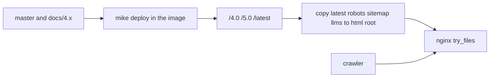

# Canonical docs discoverability - Plan

## Goal Capsule

- **Objective:** A search engine or an AI crawler that starts at `https://mkdocs.python-cqrs.dev/` can fetch the crawl rules, the page list, and the model index, and the pages those tools are asked to prefer are the current documentation.
- **Means:** Publish the latest copies of those files at the host root, and keep older version pages canonicalized to `/latest/` (KTD1, KTD4).
- **Authority:** Requirements govern behavior. Key Technical Decisions govern mechanism. This capsule adds no third rule.
- **Execution profile:** Smoke the mike-built tree and the image copy. This repo has no site test suite.
- **Stop conditions:** Stop if a change would `Disallow` a training crawler, `noindex` a version, commit root discovery files onto `gh-pages`, or clear `canonical_version`.
- **Who finishes:** The implementer lands U1–U5. The site operator rebuilds the Timeweb image after those refs are on the remotes the image clones, then submits the sitemap. Console submission is operator work described by R5, not a CI gate.

## Product Contract

### Summary

On the canonical docs host, crawlers will find `robots.txt`, the sitemap, and the model index at the origin root. The rules will allow fetching and will say yes to search, AI input, and AI training. Only the current version is the URL search should prefer. The GitHub Pages mirror is out of this work.

### Problem Frame

Crawlers request `/robots.txt` and `/sitemap.xml` on the host root. mike writes those files inside each version directory, and the host root answers 404. The page template concatenates `site_url` with `llms.txt`. During `mike deploy`, that `site_url` has no trailing slash, so the alternate link becomes `latestllms.txt`. The current version should be what search and AI answers prefer, and the site should say yes to AI search and training in a form that does not block ordinary indexing.

### Key Decisions

- **Canonical host only.** Root discovery files are served on `https://mkdocs.python-cqrs.dev/` and are not added to the GitHub Pages tree. (session-settled: user-directed — chosen over also fixing the GitHub Pages mirror: the user limited this work to the canonical domain). Governs R1.
- **Explicit AI search and training preference.** The crawl file records yes for search, AI input, and AI training, and it does not forbid training crawlers. (session-settled: user-directed — chosen over discovery files and sitemap submission alone: the user asked for that explicit consent). Governs R3.
- **Current version is the search target.** Older pages stay readable and point their canonical URL at `/latest/`. They are not given their own sitemap entries. (session-settled: user-directed — chosen over separate 4.x search results: the user wants only the current version suggested). Governs R4.

### Requirements

**Host discovery**

- R1. `https://mkdocs.python-cqrs.dev/robots.txt`, `/sitemap.xml`, `/llms.txt`, and `/llms-full.txt` return the copies from the latest version.
- R2. On that host, the LLM alternate link on pages under `/latest/`, `/5.0/`, and `/4.0/` is `https://mkdocs.python-cqrs.dev/latest/llms.txt`.

**AI preference**

- R3. The root `robots.txt` allows every crawler to fetch the site and records `search=yes`, `ai-input=yes`, and `ai-train=yes` in that same group, with no `Disallow`.

**Version indexing**

- R4. Versioned pages stay crawlable, keep `index, follow`, and keep a canonical URL under `/latest/`. The root sitemap lists only those `/latest/` URLs.

**Operator handoff**

- R5. `VERSIONING.md` tells the operator to verify the canonical host with a DNS TXT record and to submit the root sitemap in Google Search Console and Yandex Webmaster.
- R6. Markdown under `docs/plans/` is omitted from the built site and from `sitemap.xml`.

### Actors

- A1. Search and AI crawlers, which read only the host-root `robots.txt` and then the sitemap URL it names.
- A2. The site operator, who rebuilds the Timeweb image and submits the sitemap after the refs exist.
- A3. Readers of frozen 4.x pages, who still need those URLs to return the old text.

### Key Flows

- F1. Crawler discovery
  - **Trigger:** A crawler requests the canonical host.
  - **Actors:** A1
  - **Steps:** It fetches `/robots.txt`, then the sitemap URL in that file, then the HTML pages listed there. Each HTML page exposes the model index through the alternate link.
  - **Outcome:** The fetched rules, page list, and model index are the latest version.
  - **Covered by:** R1, R2, R3, R4
- F2. Operator submission
  - **Trigger:** The image that contains the root files is deployed.
  - **Actors:** A2
  - **Steps:** The operator proves ownership with DNS, then submits `https://mkdocs.python-cqrs.dev/sitemap.xml`.
  - **Outcome:** Both consoles fetch a sitemap of `/latest/` URLs. No verification file is added to the repo.
  - **Covered by:** R5

### Acceptance Examples

- AE1. Root crawl file
  - **Covers:** R1, R3
  - **Given:** The image has copied the latest `robots.txt` to the html root.
  - **When:** A client fetches `https://mkdocs.python-cqrs.dev/robots.txt`.
  - **Then:** The body has one `User-agent: *` group, `Content-Signal` with all three values `yes`, `Allow: /`, a final `Sitemap` line for the root sitemap, and no `Disallow`.
- AE2. Root sitemap
  - **Covers:** R1, R4
  - **Given:** The image has copied the latest sitemap to the html root.
  - **When:** A client fetches `https://mkdocs.python-cqrs.dev/sitemap.xml`.
  - **Then:** Every `loc` is under `https://mkdocs.python-cqrs.dev/latest/`, and none point at `/4.0/` or `/5.0/`.
- AE3. Alternate link
  - **Covers:** R2
  - **Given:** A mike build of 5.0 and of 4.0 with `canonical_version: latest` and the canonical `site_url`.
  - **When:** A client reads `extrahead` on a page from either build.
  - **Then:** The alternate href is `https://mkdocs.python-cqrs.dev/latest/llms.txt`.
- AE4. Old version still consolidates
  - **Covers:** R4
  - **Given:** A mike build of 4.0 with `canonical_version: latest` and the canonical `site_url`, and a page whose matching latest page exists.
  - **When:** A client reads that page.
  - **Then:** The robots meta is `index, follow`, and the canonical href is the matching `/latest/` URL on the canonical host.

### Scope Boundaries

- Root discovery files on the GitHub Pages mirror.
- A `Disallow` for any training or search crawler.
- `noindex` or `Disallow` on `/4.0/` or `/5.0/`.
- Clearing or retargeting `canonical_version`.
- An HTML verification file in git or on `gh-pages`.
- Rewriting `site_url` in `.github/workflows/ci.yaml` on `docs/4.x`.

#### Deferred to Follow-Up Work

- 4.x URLs whose canonical target on `/latest/` is a 404 because the page moved, including `/4.0/migration/upgrade-to-5/` against `/latest/migration/4-to-5/`. Leave `canonical_version` as it is. Submit only the root sitemap.
- Aligning the `docs/4.x` workflow, which still rewrites `site_url` to `vadikko2.github.io` before `mike deploy`. Changing that rewrite would retarget 4.0 canonicals on the mirror.

### Sources

- Live host on 2026-10-13: `/robots.txt` and `/sitemap.xml` and `/llms.txt` 404; `/latest/robots.txt`, `/latest/sitemap.xml`, and `/latest/llms.txt` answer; page canonicals already point at `/latest/`; the alternate href is `latestllms.txt`.
- mike 2.2.0 `on_config` sets `site_url` with `urljoin` and no trailing slash when `canonical_version` is set. MkDocs adds the slash only for `page.canonical_url`. An open trailing-slash change is mike PR 251, not in 2.2.0.
- RFC 9309 and Google's robots parser: `/robots.txt` is read only at the host root. Google parses `user-agent`, `allow`, `disallow`, and `sitemap`. `Allow: /` matches having no file. A named group replaces `*`. An ignored line that is the only record between two `User-agent` lines can merge those groups.
- Cloudflare Content Signals (`https://contentsignals.org/`): `Content-Signal: search=yes, ai-input=yes, ai-train=yes` inside a user-agent group. Google, OpenAI, and Anthropic do not document reading it. Their training opt-out is `Disallow` on a named token.
- MkDocs 1.6 `exclude_docs` drops files from the build and the sitemap. `not_in_nav` does not. `draft_docs` still serves them under `mkdocs serve`.
- `origin/docs/4.x:.github/workflows/ci.yaml` still rewrites `site_url` to the old GitHub Pages host. `master`'s workflow does not.

## Planning Contract

### Key Technical Decisions

- KTD1. **Copy latest's four files onto the image html root after `git archive`.** `Dockerfile` already builds its own mike tree and extracts it to the nginx root. `nginx/default.conf` serves a root file that exists, the same way it serves `versions.json`. Copy `latest/robots.txt`, `latest/sitemap.xml`, `latest/llms.txt`, and `latest/llms-full.txt` there. Do not commit those paths on `gh-pages`. The image clones `master` and `docs/4.x`; a docs change is invisible to that clone until those refs contain it. `nginx/default.conf` and `Dockerfile` come from the image build context. (session-settled: user-directed — chosen over publishing the same root files on the GitHub Pages mirror: the user limited discovery files to the canonical host). Governs R1. Conflict: `docs/robots.txt` and `overrides/main.html` are shared source, so CI will still publish the version-directory copies on the mirror. The mirror's host root stays without these four files.
- KTD2. **One `User-agent: *` group, with the preference line beside `Allow`.** Put `Content-Signal: search=yes, ai-input=yes, ai-train=yes` and `Allow: /` in that single group. End the file with `Sitemap: https://mkdocs.python-cqrs.dev/sitemap.xml`. Delete the named `Allow` groups. Do not add a `Disallow`. Comments may name `/llms.txt` and `/llms-full.txt` once those root copies exist; a comment is not what crawlers fetch. (session-settled: user-directed — chosen over a discovery-only file with no AI preference line: the user asked for explicit consent). Governs R3. Conflict: Google ignores `Content-Signal`, and OpenAI, Anthropic, Perplexity, Apple, Meta, Amazon, and Common Crawl document `Disallow` on a named token as the control they read. Repeating `Allow` per bot does not record consent, and a named group stops that bot from inheriting `*`. The explicit yes the user asked for is the Content-Signal line inside the allow group. Leaving training tokens on `*` is what keeps training allowed. A later edit must not put `Content-Signal` in a group that has no `Allow` or `Disallow`, or Google can glue that group to a following `Disallow` and block `Googlebot`.
- KTD3. **Build the alternate href from `site_url` after adding a trailing slash.** mike's rewritten `site_url` is the canonical version without a slash (`https://mkdocs.python-cqrs.dev/latest`). Appending `llms.txt` to that string drops the slash. Joining `llms.txt` with `urljoin` onto the unsuffixed URL drops `latest` entirely. Add the slash, then append `llms.txt`, so a mike build emits `https://mkdocs.python-cqrs.dev/latest/llms.txt` on both 5.0 and 4.0 pages. Keep the robots meta at `index, follow`. Do not clear `canonical_version`. Apply the template on `master` and on `docs/4.x`, because the image builds `/4.0/` from `docs/4.x`. Judge success on the image after its `site_url` substitution, not on the `gh-pages` HTML from `docs/4.x` CI. That workflow still substitutes the old GitHub Pages host, so the mirror's alternate href will use that host. Do not edit the workflow to force the canonical host into the mirror. Governs R2, R4.
- KTD4. **Keep old versions crawlable and leave them out of the submitted sitemap.** Do not `Disallow` or `noindex` `/4.0/` or `/5.0/`. A disallowed URL is not fetched, so its canonical is invisible. `noindex` drops the URL instead of consolidating it. `canonical_version: latest` already makes both version sitemaps list `/latest/` URLs. The root sitemap is the latest file, not the shorter `/4.0/` file. `/4.0/` has no normal link from latest and is absent from that sitemap; that is acceptable. Say so in `VERSIONING.md`. (session-settled: user-directed — chosen over indexing 4.x as its own search results: the user wants only the current version suggested). Governs R4. When 4.x text differs from latest, a crawler may ignore the canonical and keep both URLs. This plan does not add redirects.
- KTD5. **Keep the plan and the operator notes out of the published docs.** Set `exclude_docs` to `/plans/` in `mkdocs.yml`. MkDocs 1.6 then omits that tree from `mkdocs build` and from the sitemap. `not_in_nav` would still publish it. Put the console steps in `VERSIONING.md`, which sits outside `docs_dir`. Document DNS verification only. A token file under `docs/` would be published at `/latest/`, and a token committed on `gh-pages` would break KTD1. Governs R5, R6.

Copying files in the image was not developed as a bake-off against committing them on `gh-pages`. The mirror decision removes the second option, and reversing an image copy is a config change.

### Sequencing

U1 lands in the same change that brings this plan file to `master`, so the plan page never enters a sitemap. U2 lands on `master`. U3 lands on `master` and `docs/4.x` before an image build can see them, because `Dockerfile` clones those refs and does not copy `docs/` from the build context. U4 is the copy and the image check. U5 can land with U4. The operator runs F2 only after that image is deployed.

### High-Level Technical Design

`/latest/` and `/5.0/` stay duplicate trees. Their canonical URLs and the root sitemap both name `/latest/`. `/4.0/` stays a separate tree whose canonical URLs also name `/latest/`.

## Implementation Units

### U1. Omit plans from the published site

- **Goal:** R6. This plan file must not become a public docs page.
- **Requirements:** R6
- **Dependencies:** none
- **Files:** `mkdocs.yml`
- **Approach:** Set `exclude_docs` so `/plans/` is excluded from the build and the sitemap, per KTD5. Do not add a nav entry for this file. `strict: true` fails if nav points at an excluded page.
- **Patterns to follow:** MkDocs already excludes `/templates/` by default. `mkdocs.yml` has no `exclude_docs` today.
- **Test scenarios:**
  - With `docs/plans/2026-10-13-1541-docs-canonical-discoverability-plan.md` present and absent from `nav`, `mkdocs build --strict` finishes and `site/plans/` does not exist.
  - `site/sitemap.xml` from that build contains no `plans` loc.
  - A nav entry that points at the plan file fails the strict build.
- **Verification:** The built site and its sitemap have no plan page. `mkdocs serve` also hides the tree, which is the MkDocs 1.6 `exclude_docs` behavior.

### U2. Rewrite the crawl file

- **Goal:** The file mike copies into each version, and that U4 then copies to the host root, matches R3.
- **Requirements:** R3. Key Decision "Explicit AI search and training preference."
- **Dependencies:** none
- **Files:** `docs/robots.txt` on `master`
- **Approach:** Replace the named `Allow` groups with the single group in KTD2. Keep the root sitemap URL. Point comments at `/llms.txt` and `/llms-full.txt`. The root copy comes from `latest`, which is built from `master`. Leave `docs/4.x` unchanged for this file. Crawlers do not read `/4.0/robots.txt`.
- **Patterns to follow:** The current file is a static copy under `docs/`, not a template.
- **Test scenarios:**
  - The file contains one `User-agent` line, the `*` token, `Content-Signal` with `search=yes`, `ai-input=yes`, and `ai-train=yes`, and `Allow: /` in that group.
  - `Sitemap` is the last directive and its URL is `https://mkdocs.python-cqrs.dev/sitemap.xml`.
  - The file contains no `Disallow` and no second `User-agent`.
- **Verification:** Reading both copies shows KTD2. A mike build of `master` places that body at `latest/robots.txt`.

### U3. Fix the model-index link

- **Goal:** R2 on the canonical host, without moving canonical targets off `/latest/`.
- **Requirements:** R2, R4
- **Dependencies:** none
- **Files:** `overrides/main.html` on `master` and on `docs/4.x`
- **Approach:** Per KTD3, normalize `site_url` to end with `/` before appending `llms.txt`. Leave the robots meta behavior as it is, including the per-page override. Do not change `plugins.mike.canonical_version` in `mkdocs.yml`. Do not edit `.github/workflows/ci.yaml` on `docs/4.x`.
- **Execution note:** Prove the href with `MIKE_DOCS_VERSION` set, or with `mike deploy` into a local tree. A plain `mkdocs build` keeps the trailing slash on `site_url` and will stay green even if the template regresses to concatenation.
- **Patterns to follow:** `overrides/main.html` already fills `extrahead`. Material prints `page.canonical_url`, which is already slash-safe. Do not read `config.site_url` by raw concatenation.
- **Test scenarios:**
  - A mike build with `canonical_version: latest` and `site_url` `https://mkdocs.python-cqrs.dev/` emits an alternate href of `https://mkdocs.python-cqrs.dev/latest/llms.txt` on a 5.0 page and on a 4.0 page.
  - Those pages still canonicalize to `https://mkdocs.python-cqrs.dev/latest/...` and still say `index, follow`.
  - A plain `mkdocs build` without `MIKE_DOCS_VERSION` emits an href that ends in `/llms.txt` and does not contain `latestllms.txt`.
  - No built HTML under `4.0/` or `5.0/` contains the string `latestllms.txt`.
- **Verification:** The image's `/4.0/` and `/5.0/` HTML match AE3 and AE4. The `gh-pages` copy produced by `docs/4.x` CI may show the old GitHub Pages host in the alternate href and in canonicals. That is not a failure of R2 or AE4.

### U4. Publish the root files from the image

- **Goal:** R1. The canonical host root serves the four latest files.
- **Requirements:** R1
- **Dependencies:** U2, U3. Those edits must be on the remotes `Dockerfile` clones before a full image build can see them.
- **Files:** `Dockerfile`
- **Approach:** After the archive is extracted and the `latest` symlink is materialized, copy the four files from `latest/` onto the html root, per KTD1. Fail the image build if any of the four root paths is missing, or if any HTML file under `4.0/` or `5.0/` contains `latestllms.txt`. Do not add a root file to the `gh-pages` branch.
- **Execution note:** This is image packaging. Smoke the extracted tree. Do not add a unit-test suite.
- **Patterns to follow:** The existing `latest` symlink materialization in `Dockerfile`. `nginx/default.conf` already uses `try_files` for paths other than `/` and `/index.html`.
- **Test scenarios:**
  - After the copy, the html root `robots.txt` byte-matches `latest/robots.txt`, and the same holds for `sitemap.xml`, `llms.txt`, and `llms-full.txt`.
  - The image build fails when `latest/sitemap.xml` is absent.
  - The image build fails when a file under `5.0/` or `4.0/` contains `latestllms.txt`.
  - `location = /` still redirects to `/latest/`. A request for `/robots.txt` is not redirected.
- **Verification:** Against a tree built the way the image builds it, the four root URLs would return 200 with the latest bodies, and AE2 holds for the root sitemap. A full `docker build` confirms this only after U2 and U3 are on the cloned refs, because the Dockerfile clones the remotes instead of copying `docs/` from the build context.

### U5. Document console submission

- **Goal:** R5. The operator can submit the sitemap without putting a verification file in the repo.
- **Requirements:** R5, R4
- **Dependencies:** U4, for the URL that the notes name
- **Files:** `VERSIONING.md`
- **Approach:** Per KTD4 and KTD5, document DNS TXT verification for Google Search Console and Yandex Webmaster, submission of `https://mkdocs.python-cqrs.dev/sitemap.xml`, and the fact that `/4.0/` is not in that sitemap. State that the Timeweb image is rebuilt from a Dockerfile that contains U4, after `master` contains U2 and both `master` and `docs/4.x` contain U3. Do not add an HTML token or a docs page for this.
- **Patterns to follow:** `VERSIONING.md` already describes the Timeweb image and the canonical host.
- **Test scenarios:**
  - Test expectation: none — this unit is operator prose. Confirm by reading that the sitemap URL, DNS verification, the `/4.0/` omission, and the image rebuild are all present, and that no verification filename is introduced under `docs/` or `gh-pages`.
- **Verification:** A reader who has not seen this plan can perform F2 from `VERSIONING.md` alone.

## Verification Contract

| Check | When | Done when |
|---|---|---|
| `mkdocs build --strict` | U1, and the existing CI asset check | Build exits 0, `site/plans/` is absent, and `site/stylesheets/extra.css` and `site/javascripts/star-link.js` still exist |
| Mike build of 5.0 and 4.0 with the canonical `site_url` | U3 | AE3 and AE4 hold, and no HTML contains `latestllms.txt` |
| Image tree after archive and copy | U4 | The four root files match `latest/`, and the build fails if a root file or the slash check fails |
| Read `docs/robots.txt` on both refs | U2 | AE1's body rules hold in the source file |
| Read `VERSIONING.md` | U5 | F2 can be followed without a new file in `docs/` |

There is no site unit-test command. `pre-commit` covers YAML, JSON, and whitespace. `mkdocs build --strict` does not set `MIKE_DOCS_VERSION`, so it does not prove R2.

## Definition of Done

- R1–R6 hold on the canonical host after the image that contains U4 is deployed, except R5, which holds when `VERSIONING.md` describes F2.
- U1 is in the same merge to `master` as this plan file.
- U2 is on `master`. U3 is on both `master` and `docs/4.x`.
- No root discovery file was committed on `gh-pages`.
- `canonical_version` is still `latest`. No version page is `noindex`. The crawl file has no `Disallow`.
- Abandoned experiments from this work are not left in the diff.

## Risks & Dependencies

- **Content-Signal is not a receipt.** Training stays allowed because those tokens are not disallowed. Crawlers that ignore the preference line behave as they do for any site with `Allow: /`. See KTD2.
- **Canonical collapse is not guaranteed when 4.x text differs from latest.** Some 4.x URLs can remain searchable. The root sitemap is only an extra hint. Redirecting `/4.0/` would hide the frozen docs from A3.
- **A 4.x canonical target can 404.** `/4.0/migration/upgrade-to-5/` canonicalizes to a latest path that does not exist. Google can drop that canonical and index the 4.0 URL. Deferred above. Do not submit `/4.0/sitemap.xml`. Its locs repeat `/latest/` and include that dead URL.
- **The image clones remotes.** Rebuilding Timeweb from a commit that only changes `Dockerfile` will copy whatever `latest/robots.txt` is on the cloned `master`. U2 must be on that ref first.
- **`docs/4.x` CI still rewrites `site_url`.** The mirror's 4.0 alternate link will use the GitHub Pages host. Treat that as out of scope, not as a failed R2 check.
